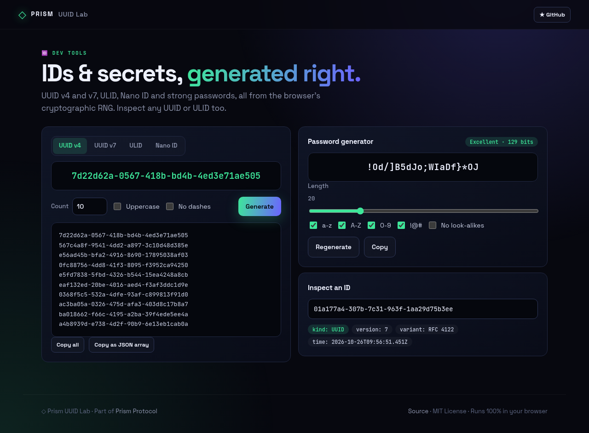
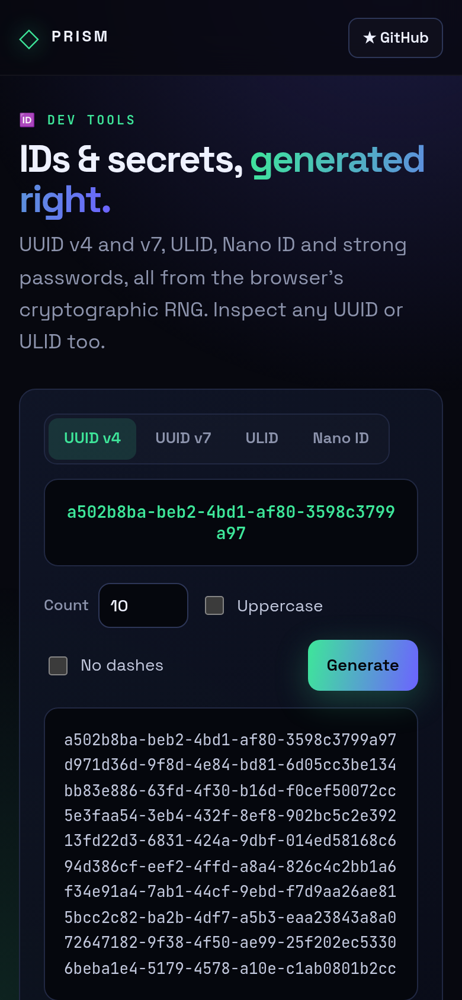

<!-- ═════════════ HEADER ═════════════ -->
<p align="center">
  
</p>

<p align="center">
  
</p>

<p align="center">
  <a href="https://github.com/krishyaa06/prism-uuid-lab/actions/workflows/ci.yml"></a>
  <a href="https://krishyaa06.github.io/prism-uuid-lab/"></a>
  
  
  <a href="LICENSE"></a>
</p>

<p align="center">
  
</p>


## ⚡ Overview

**Prism UUID Lab** generates identifiers and secrets using `crypto.getRandomValues`, never `Math.random`. Pick UUID v4, time-ordered UUID v7, ULID or Nano ID, generate up to 500 at once, and copy them as text or a JSON array. A password generator with an entropy meter and an inspector that reveals the version and embedded timestamp of any UUID or ULID are included.

## ✨ Features

- **UUID v4** (random) and **UUID v7** (time-ordered, RFC 9562)
- **ULID** and **Nano ID** with custom length
- **Bulk** generation, uppercase / no-dash options, JSON export
- **Password generator** guaranteeing every selected character class, with unbiased sampling
- **Entropy meter** (bits + label) and look-alike character filter
- **Inspector** shows version, variant and timestamp

## 📸 Screenshots

<table>
  <tr>
    <td width="68%"></td>
    <td width="32%"></td>
  </tr>
</table>

## 🚀 Quick Start

**Use it online:** [https://krishyaa06.github.io/prism-uuid-lab/](https://krishyaa06.github.io/prism-uuid-lab/)

**Run locally:**

```bash
git clone https://github.com/krishyaa06/prism-uuid-lab.git
cd prism-uuid-lab
# open index.html in your browser, or serve it:
npx serve .
```

## 🛠️ Usage

- Choose an ID type, set a count and press **Generate**. Click the big ID to copy it.
- Adjust password length and character sets; click the password to copy.
- Paste an ID into **Inspect** to see its version and creation time.

## 📁 Project Structure

```
prism-uuid-lab/
├── assets/
│   ├── logo.png
│   └── logo.svg
├── css/
│   ├── app.css
│   └── prism.css
├── js/
│   ├── app.js   # UI wiring
│   ├── core.js   # ID + password generators — tested in Node
│   └── prism.js
├── test/
│   └── core.test.js
├── .gitignore
├── LICENSE
├── index.html
└── package.json
```

## 🧪 Tests

```bash
npm test
```

Tests use the built-in `node:test` runner, so there is nothing to install. CI runs them on Node 20 and 22.

## 🤝 Contributing

1. Fork the repo and create a branch: `git checkout -b feature/my-idea`
2. Make your change and add a test in `test/`
3. Run `npm test` and open a Pull Request

## 🔷 Part of Prism Protocol

Prism UUID Lab is one of the open-source tools built by [Prism Protocol](https://dc.gg/prismprotocol), a tech community where young builders learn, ship and compete together.

## 👤 Author

<table>
  <tr>
    <td align="center">
      <a href="https://github.com/krishyaa06"><br><b>Soumya Bhandare</b></a><br>
      <sub>Founder @ Prism Protocol</sub>
    </td>
    <td>
      <a href="https://dc.gg/prismprotocol"></a><br>
      <a href="https://instagram.com/prism_protocol_"></a><br>
      <a href="https://x.com/krishyaa06"></a>
    </td>
  </tr>
</table>

## 📄 License

Released under the [MIT License](LICENSE).

<p align="center">
  <b>If you like this project, consider giving it a ⭐</b><br>
  <sub>"Build. Create. Compete." · Made with ⚡ by Prism Protocol</sub>
</p>


